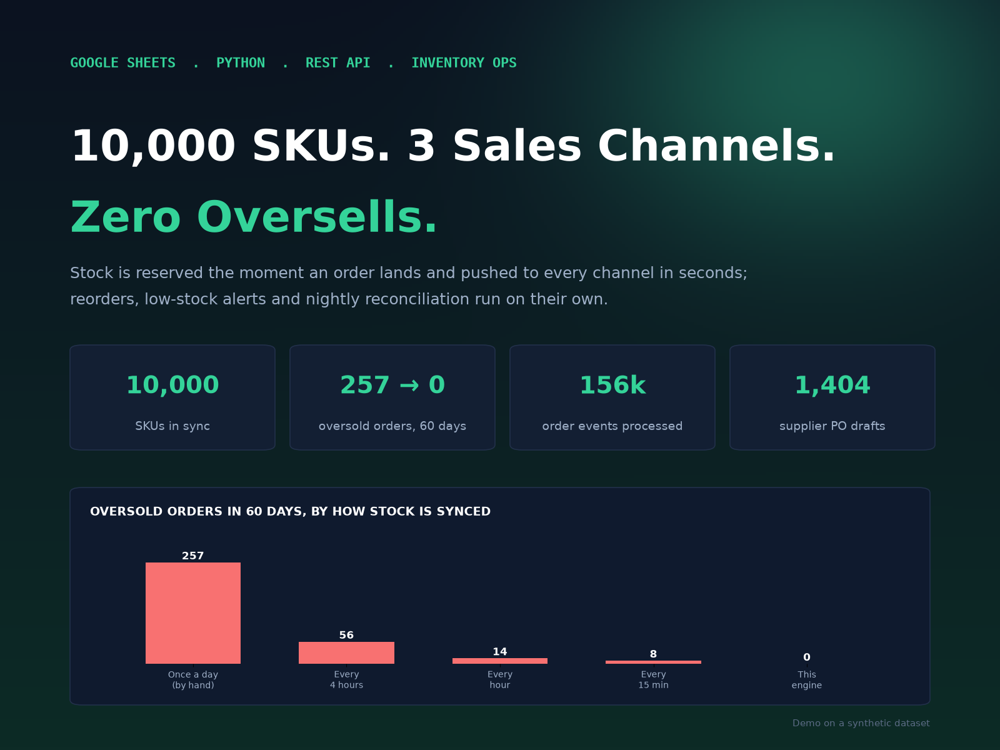
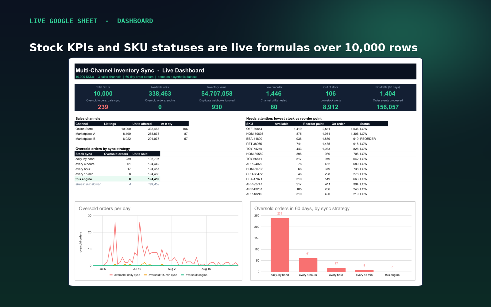
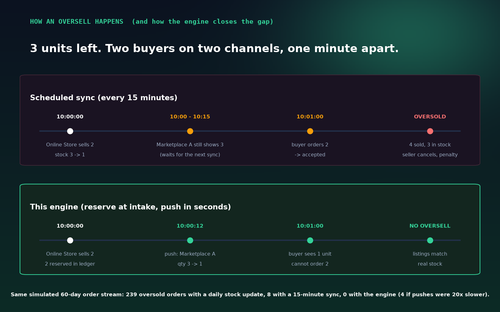
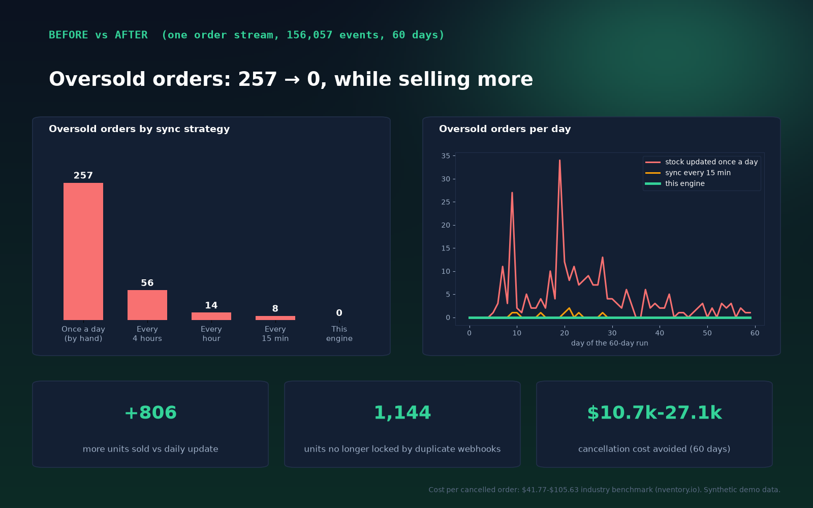

# Multi-Channel Inventory Sync - 10,000 SKUs, 3 channels, zero oversells



An inventory-sync engine for sellers who list the same stock on several channels.
Stock is **reserved the moment an order lands** and the new quantity is **pushed to every
channel within seconds**, so a second channel can no longer sell units that are already gone.
Around it: low-stock alerts, nightly supplier purchase-order drafts, a reconciliation sweep
and an audit trail - all published into a live Google Sheet.

> **Demo on a synthetic dataset.** 10,000 SKUs, 3 channels and a 60-day order stream are
> generated with a fixed random seed. No real brands, stores, customers or orders.
> Channel APIs are simulated; the engine logic is the real thing.

## Results (same 156,057-event order stream for every strategy)

| How stock is synced | Oversold orders (60 days) | Units sold |
|---|---:|---:|
| Once a day (spreadsheet updated by hand) | 257 | 193,641 |
| Every 4 hours | 56 | 194,296 |
| Every hour | 14 | 194,310 |
| Every 15 minutes | 8 | 194,313 |
| **This engine** (event-time reservation + push) | **0** | **194,447** |

- **1,144** units no longer locked by phantom reservations from re-delivered webhooks
- **90** channel updates that "succeeded" but never landed - found and healed overnight (2,598 units back on sale)
- **1,404** supplier PO drafts (8,748 lines, reorder point / EOQ), grouped per supplier
- **8,897** low-stock alerts in 3,701 digests instead of 16.3M repeated "still low" pings
- **~240k** channel API writes vs **141M** for a full-catalogue push every 15 minutes
- Avoided cancellation cost: **$10.7k-$27.1k** over 60 days at a $41.77-$105.63 per-order industry benchmark (nventory.io)

## How the engine works

1. **Idempotent intake** - every order event is keyed by its channel order id; re-delivered webhooks are ignored.
2. **Append-only reservations ledger** - `reserved` is always the sum of open reservations (audited nightly).
3. **Available-to-sell** = on hand - reserved - publish buffer (buffer only on hot SKUs, to absorb push latency).
4. **Event-time push** to every channel with per-channel latency; pushes for the same listing are coalesced.
   Decreases are confirmed by read-back; increases are best effort and healed by reconciliation.
5. **Low-stock alerts** are edge-triggered (one per crossing of the reorder point) with a 24h cooldown,
   sent as one digest per cycle.
6. **Nightly job**: (s, Q) reorder policy - when stock position <= reorder point, draft a line of
   `max(EOQ, enough to clear the reorder point)`; lines are grouped into one PO per supplier.
   Then the ledger audit and the channel reconciliation sweep run.

Formulas: `safety stock = Z x sigma_d x sqrt(L)`, `reorder point = d x L + safety stock`,
`EOQ = sqrt(2 x D x S / H)`. All parameters live in [`rules.yaml`](rules.yaml).

Optional policies (off by default, measured): offer caps per channel and "last units only on the
fastest channel" - on this dataset they cut sell-through by ~1% without removing further oversells.

## Every run proves itself

`src/pipeline.py` stops with an error if any of these break:
zero oversold orders, ledger == reserved for every SKU, no negative stock, no channel offered more
than available, replaying the full feed twice changes nothing, every re-delivered webhook ignored,
PO lines only at/below the reorder point, PO qty never below EOQ, no repeat alert inside cooldown.

## Run it

```bash
pip install -r requirements.txt
python src/generate.py        # synthetic catalogue, listings, 60-day order feed  -> data/
python src/pipeline.py        # baselines + engine + replay + invariant checks    -> out/
python -m pytest -q tests     # unit tests: race, idempotency, alerts, reconciliation, POs
python src/visuals.py         # slides -> screens/
```

Publishing to Google Sheets (optional): share a spreadsheet with your service account, set
`GOOGLE_CREDENTIALS` to its key file, then `python src/to_gsheet.py <spreadsheet id>` and
`python src/sheet_snapshots.py` (Google renders the tabs via PDF export - no browser needed).

## Layout

```
rules.yaml               every parameter of data, engine and reorder policy
src/generate.py          synthetic 10k-SKU catalogue, channel SKU mapping, order feed
src/engine.py            event-driven simulation: naive scheduled sync vs this engine
src/pipeline.py          runs all strategies, checks invariants, writes out/
src/to_gsheet.py         live Google Sheet: dashboard, inventory, POs, alerts, audit
src/sheet_snapshots.py   browser-free snapshots of the sheet
src/visuals.py           portfolio slides
tests/test_engine.py     unit tests on hand-built scenarios
out/                     inventory master, reservations ledger, PO drafts, alerts,
                         reconciliation, audit log, before/after, metrics.json
```




